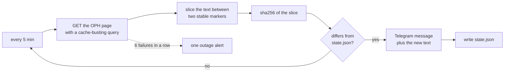

# yki-monitor

Watches the OPH page that announces YKI certificates and sends a Telegram message when the
section changes.

## Why it exists

The Finnish National Certificate of Language Proficiency results are announced by quietly editing
a section of a public page. There is no feed, no email, and no date you can rely on. So you poll it.

## How it works



Two details carry most of the weight.

The page sits behind a CDN that serves copies several days stale and ignores the origin's
`no-cache` headers, so a plain poll can report the same old text forever. Appending a unique query
string forces a fresh origin fetch. The comment in `fetch_section()` records what that looked like
in the response headers.

The extraction is marker-based rather than selector-based. It takes the page's visible text,
normalises the whitespace, and slices between two literal strings that are unlikely to move. A
CSS selector would break on the next redesign; a marker pair only breaks if the wording changes,
and when it does the monitor says so instead of quietly reporting "no change" forever.

Outages are separated from changes on purpose. Six consecutive failed polls (about thirty minutes)
trigger one alert, so a scheduled maintenance window does not produce a hundred messages.

## Run

```bash
python3 -m venv venv
venv/bin/pip install -r requirements.txt

export TELEGRAM_BOT_TOKEN=...
export TELEGRAM_CHAT_ID=...
python3 monitor.py
```

`run.sh` does the same thing after loading those two variables from a local `.env`. State lives in
`state.json` beside the script and is the only file it writes. Both are gitignored.

Poll it from cron or a launchd job every five minutes; 288 requests a day is nothing to the origin.

## Limits

It alerts on any change inside the section, including edits that do not concern you. That is the
right trade for a page with no structure to key on, but it means a routine copy edit produces a
notification.
